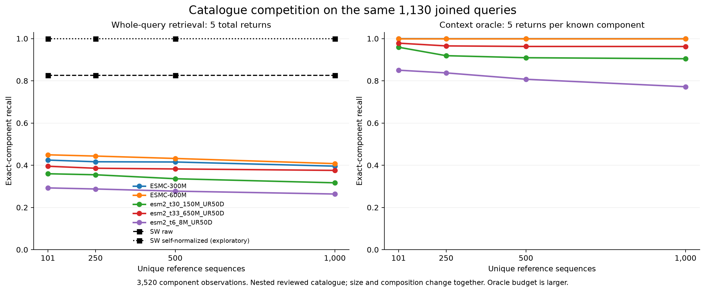

# IRI research session — 31 October 2026

**Larger models improve component retrieval, but local alignment remains the strongest tested approach on this exact-reference panel.** Automatic windows improve embeddings substantially; alignment-guided segmentation matches a much simpler normalized-alignment baseline. The evidence supports a useful benchmark and a mechanism diagnosis, not a novel screening method.

## What completed

Five models—ESM-2 8M, 150M and 650M; ESMC 300M and 600M—completed the frozen 1,146-query suite, all core pooling controls, and the nested 101/250/500/1,000-reference comparison. Raw and exploratory normalized Smith–Waterman completed the same comparisons. Four models completed automatic segmentation; reference-removal, order, context-distance, equal-weighting and failure analyses also completed. All results stayed local.

The session launched at **07:25:06 UTC**. The goal was subsequently amended from 10–12 hours to **up to eight hours**, ending the research window at 15:25:06 UTC. Oversight was interrupted by usage limits after approximately 11:36 UTC; already-queued alignment finished around 12:40 UTC. On resuming at 16:53 UTC, work was restricted to saved-output verification, reporting and recovery. This was not uninterrupted work for ten hours. The [amendment record](./audit/session_limit_amendment_8h_v1.json) preserves that distinction and the original launch manifest.

## 1. Stronger representations help, but complete recovery remains weak

The core catalogue contains 105 accessions representing 101 unique sequences. The common evaluation comprises 1,130 joined queries and 3,520 component observations; 16 clean queries are reported separately. Every row below returns **five hits total per query**. Component recall measures recovered components; “all recovered” measures queries with every component found.

| Method | Component recall@5 | Queries with all components recovered@5 |
|---|---:|---:|
| ESM-2 8M, whole query | 29.26% | 1.68% |
| ESM-2 150M, whole query | 35.94% | 5.84% |
| ESM-2 650M, whole query | 39.52% | 7.79% |
| ESMC 300M, whole query | 42.44% | 9.47% |
| ESMC 600M, whole query | 44.94% | 10.44% |
| Raw Smith–Waterman | 82.56% | 58.94% |
| Reference-self-normalized Smith–Waterman, exploratory | 100% | 100% |

Whole-query ESMC 600M finds at least one component in 94.42% of queries, yet all components in only 10.44%. “Any hit” therefore hides substantial failure. None of the five whole-query models recovers every component of any four-component query at five total returns. [Source tables](./jobs/compare-core-five-models-v1-fb9fecb900a2/exports/headlines.csv).

## 2. More components, smaller fractions and more competitors expose failures

Whole-query recall@5 for two/three/four components is **52.4/31.9/18.9%** for 8M and **67.4/46.9/35.6%** for ESMC 600M. For components occupying less than one-quarter of their query, recall is only **1.77%** and **10.37%**, respectively. Position summaries are unadjusted and confounded by component identity, length and partners. Across 680 matched target/group cells per model, reordering flips top-five hit status in 27/37/34/39/31 cells for 8M/150M/650M/300M/600M. The isolated mixtures have no rank changes under the saved numerical tolerance. Four-component groups cover eight of 24 permutations, with balanced positions; these are correlated observations, not independent trials.

With the same queries and a deduplicated catalogue growing from 101 to 1,000 references, whole-query recall falls from **29.26% to 26.36%** for 8M and **44.94% to 40.77%** for ESMC 600M. Raw and normalized alignment remain at 82.56% and 100%. Catalogue size and competitor composition change together; the 101-reference baseline is distinct from the 105-accession table. [Complete competition table](./analysis/expanded-catalogue-closeout-v1-cd8aa1563580/catalogue_comparison.csv).

[Fraction/position figure](./analysis/failure-profile-v1-3ff70216e42c/failure_profile.png) · [Deterministically selected counterexamples](./jobs/compare-core-five-models-v1-fb9fecb900a2/exports/cases.json) · [Order analysis](./analysis/order-sensitivity-v1-9251ea4b145d).

## 3. Alignment already solves the easiest component task

Raw local alignment recovers the exact full-reference spans for all 3,536 components, including clean queries, but its length-sensitive ranking leaves 614 joined components outside the top five. Dividing by each reference's self-alignment score removes those misses here. That normalization was designed after the representative trial and is explicitly exploratory; it is not a calibrated detector.

Automatic segmentation used no target boundaries during prediction. Settings were selected on 180 development queries grouped by unordered component combinations, then transferred unchanged to 950 held-out combinations containing 2,988 components. The proteins themselves are shared across splits.

| Representation | Whole-query recall@5 | Automatic-window recall@5 | Window queries with all components@5 |
|---|---:|---:|---:|
| ESM-2 8M | 28.68% | 49.06% | 10.42% |
| ESM-2 150M | 35.64% | 59.77% | 19.16% |
| ESM-2 650M | 39.39% | 64.73% | 23.05% |
| ESMC 300M | 42.27% | 68.21% | 26.63% |

These comparisons use **five total returns**, merging 256-residue windows at stride 128 by maximum score. On exactly this held-out panel, raw alignment reaches 83.27%; normalized alignment and alignment-guided segmentation reach 100%. Segmentation is a tested improvement over whole-query embedding retrieval, but does not improve this endpoint over normalized alignment. [Matched segmentation table](./analysis/heldout-segment-four-model-closeout-v4-33b8c9f01052/tables/headlines.csv).

Reference-removal diagnostics use independently reviewed source-annotation family labels, not inferred functional equivalence. With exact references removed on the full panel, 2,456 components and only 340 fully scorable queries remain; normalized alignment reaches 95.40% family recall versus 49.88% for whole-query 650M and 39.50% for ESMC 300M. Absent acceptable matches are unscorable, not failures. On the held-out family panel at five total returns, normalized alignment exceeds 8M alignment-guided segmentation. At ten returns, however, that segmentation recovers 2,088/2,088 scorable components versus 2,074/2,088 for normalization: the ordering is budget-dependent. Near-90%-identity removal leaves no fully scorable four-component queries; that query statistic is undefined. [Family denominators and comparisons](./analysis/heldout-segment-four-model-closeout-v4-33b8c9f01052/family_tables/headlines.csv).

## 4. Averaging and joined context both matter

Separately encoding components and then taking a length-weighted mixture still fails to recover every component in every four-component query at five total returns—all five models recover zero complete quadruples. This identifies a pooling limitation even without joined-context changes. Context is not uniformly harmful: ESMC 600M's whole-query aggregate recall slightly exceeds its isolated mixture.

Known-boundary pooling from joined residue representations is much better, but is an oracle. At **five per component**, four-component recall is 82.01% for 8M and 100% for ESMC 600M. Under **five total** oracle returns, the corresponding completed 8M/150M/650M/300M results are 41.25/66.25/77.78/81.94%. The larger oracle budget must not be presented as an automatic-system gain.

Equal component weighting does not generally fix averaging. Whole→equal-context overall recall changes 29.26→26.08% for 8M and 44.94→45.03% for ESMC 600M, while four-component recall declines for all five models. Some small-component gains trade against losses on large components. These controls use known boundaries and remain nonlinear contrasts, not an additive causal decomposition. [Audited weighting outputs](./analysis/equal-component-weight-v1-e9b0c06e0305).

For the common 32-query 8M/650M context profiles, all 19 matched target/group contrasts show representations farther from joins closer to isolated representations. Mean far-minus-near cosine is +0.133/+0.122. This supports a localized context effect, without proving it causes retrieval errors. A fresh three-query 8M replay independently checked 41 bins and 2,207 residues. [Context evidence](./analysis/context-common-repeat-v2-9dbff8491506).

## Reliability, costs and negative results

Observed full-suite CPU FP32 runs took **47/390/1,144/598/996 seconds**, with peak process RSS **576/1,277/3,381/2,908/4,510 MiB**, for 8M/150M/650M/300M/600M. These are cache-dependent runs including controls, not standardized speed benchmarks. Core raw alignment took 358 seconds; expanded alignment took 5,334 worker seconds (5,356 including its guard). A 650M MPS attempt triggered memory pressure and was stopped; the validated CPU fallback completed.

The ledger records **76 dispatcher-managed attempts: 65 completed, eight failed, three blocked, zero unfinished and zero dispatched as skipped**, plus three completed lightweight analysis commands. Counts include retries/reporting, not 76 unique scientific experiments. Prepared but unrun work is listed in [continuation instructions](./CONTINUE.md).

All five core result sets passed independent ranking/denominator audits; alignment had independent dynamic-program checks. The frozen baseline reproduced 707 arrays and 74,130 scores exactly, with no rank changes; all 88 prior T05 files remain unchanged. The supported regression suite ran 370 tests: 369 passed and one SciPy-dependent case was skipped in T05, then passed in the existing SciPy environment. Independent weighting audit checked all 5,730 model/query evaluations and 100 fixed numerical replays. [Closeout verification](./audit/closeout_verification_v1.json) · [Tests](./audit/closeout_test_results_v1.json).

Three actual agents divided adapter, benchmark and alignment/audit work with separate ownership; root coordinated one heavy worker. Cross-agent reviews caught cleanup, dependency-path and acceptance-check gaps before admission. The weighting producer and numerical checker share an author, with a separate agent's static review; independence is not overstated. Two agents later hit usage limits, leaving drafts unreviewed.

DCTdomain compiled after a bounded SDK repair but failed its discontinuous fixture, so it was not admitted. pLM-BLAST passed numerical probe fixtures but exceeded its initial runtime allowance; a revised resource design was prepared but not executed. ESM3, intermediate-layer experiments and real benign construct scoring were not run. No real construct candidate passed record-level admission. These are limits of this session, not evidence those methods fail scientifically.

Actual interruption/resume preserved completed model records and recovered all 32 trial queries. Corruption, optional failure/blocked jobs and owned-process cleanup were also tested. Atomic unit records, completion descriptors and the append-only [ledger](./job_ledger.jsonl) are retained. Native compression preserved all logical bytes in 3,441 ranking records while reducing allocated storage by 5.12 GB. Recovery copies are checksum verified; they protect against some accidental edits, not disk failure. [Recovery snapshot](./snapshots/closeout-20261031T1704Z/snapshot_report.json).

## What this adds, and the next experiment

Local matches and coordinates are established capabilities of [BLAST](https://www.nlm.nih.gov/ncbi/workshops/2023-08_BLAST_evol/blast_basics.html). [DCTdomain](https://pmc.ncbi.nlm.nih.gov/articles/PMC11529836/) and [pLM-BLAST](https://academic.oup.com/bioinformatics/article/39/10/btad579/7277200) already address local information lost by global embeddings. Our contribution here is an audited comparison across five representations, controlled mixing/context contrasts, and automatic-window and alignment-guided tests with equal hit budgets. Nishit Kalani supplied the conceptual iterative best-hit/component approach; this does not reproduce his unavailable implementation or redistribute his presentation.

**Next, test a small independently labelled panel of public, benign, naturally divergent components and real constructs with unknown boundaries.** Admit provenance, reuse rights, annotations and reference labels first; freeze positive and negative examples and component-count strata. Compare local alignment, normalized alignment, frozen windows and an admitted domain/residue-embedding comparator at equal total returns, reporting complete recovery and false positives. The immediate priority is validating a gap beyond alignment, not adding another checkpoint. No biological sequence generation is needed. Exact self-retrieval, reference removal and held-out combinations here establish neither unseen-protein generalization, pretrained-data exclusion, biological function nor screening performance.

[Code](/Users/Rudra2.0/Desktop/IRI/iri-construct-screening-2026/scripts) · [Protocol](./inputs/PROTOCOL.md) · [Rerun and recovery instructions](./CONTINUE.md)
